# RISC-V-lite — 5-Stage Pipelined RV32I Processor

> A 5-stage pipelined RISC-V processor in SystemVerilog that runs a compiled C program (`maxx`) through memories with unknown latency. Instruction and data memories are reached through a request/ready protocol inspired by OpenHW's OBI bus. The core is taken through the full ASIC flow, from RTL through synthesis (**641 MHz**, NanGate 45 nm) to place & route in Cadence Innovus with timing met at the same clock. A second version adds OpenRAM SSRAM macros as instruction and data memories.

   

---

## Overview

The processor implements every RV32I instruction needed to run the `maxx` application, compiled with `riscv32-unknown-elf-gcc -O3`. The compiled code is run unmodified. The pipeline uses a Harvard architecture and makes no assumption about how many cycles a memory takes to answer. All memory traffic goes through a fetch unit and a load-store unit that speak a request/ready protocol.

**C Program** → **RISC-V GCC + objdump** → **RARS Reference** → **SystemVerilog RTL** → **RTL Simulation** → **Logic Synthesis (Synopsys DC)** → **Place & Route (Cadence Innovus)** → **Gate-level Simulation**

The project is built in two steps:

- **Step 1 — Core with variable-latency memories.** The core is verified against `mem_wrap_fake`, a course-provided memory model with pseudo-random latency. It is then synthesized, placed and routed, and re-verified at gate level after each stage.
- **Step 2 — Core with SSRAMs.** Two OpenRAM `sram_32_1024_freepdk45` macros are placed in a wrapper that exposes the same request/ready interface. The wrapper is synthesized and its netlist is simulated together with the core.

---

## Specification

| Parameter | Value |
|---|---|
| ISA | RV32I subset (11 base instructions) |
| Pipeline | 5 stages: IF, ID, EX, MEM, WB |
| Architecture | Harvard, 32-bit datapath, 32 × 32-bit register file |
| Memory interface | Request/ready (`PROC_REQ`, `MEM_RDY`, `ADDR`, `WE`, `WDATA`, `RDATA`, `VALID`), any latency |
| Text base address | `0x00400000` |
| Data base address | `0x10010000` |
| Stack / global pointer | `0x7FFFEFFC` / `0x10008000` |
| Target library | NanGate 45 nm Open Cell Library |
| SSRAM macro | OpenRAM `sram_32_1024_freepdk45` (1024 × 32-bit, single port, synchronous) |

### Supported Instructions

| Instruction | Type | Opcode | funct3 | funct7 | Operation |
|---|---|---|---|---|---|
| `auipc` | U | `0010111` | — | — | R[rd] = PC + imm |
| `lui` | U | `0110111` | — | — | R[rd] = imm |
| `addi` | I | `0010011` | `000` | — | R[rd] = R[rs1] + imm |
| `lw` | I | `0000011` | `010` | — | R[rd] = M[R[rs1] + imm] |
| `jalr` | I | `1100111` | `000` | — | R[rd] = PC + 4; PC = (R[rs1] + imm) & ~1 |
| `add` | R | `0110011` | `000` | `0000000` | R[rd] = R[rs1] + R[rs2] |
| `sub` | R | `0110011` | `000` | `0100000` | R[rd] = R[rs1] − R[rs2] |
| `sw` | S | `0100011` | `010` | — | M[R[rs1] + imm] = R[rs2] |
| `bltu` | SB | `1100011` | `110` | — | if (R[rs1] < R[rs2]) unsigned, PC += imm |
| `bge` | SB | `1100011` | `101` | — | if (R[rs1] ≥ R[rs2]) signed, PC += imm |
| `jal` | UJ | `1101111` | — | — | R[rd] = PC + 4; PC += imm |

The pseudo-instructions used by `maxx` (`j`, `nop`, `mv`, `li`, `ret`, `ble`) are built from these base instructions.

---

## Design Flow

### Stage 1 — Compiling the Application

`maxx` is a small C kernel (`main.c`, `maxx.c`). It combines an input `Li`, two values `Lo[]` and four values `sS[]` into four outputs `sE[]`, using max, absolute difference and a threshold correction. It is cross-compiled for RV32I using the provided `crt0.s` start-up code and `riscv32-isa.ld` linker script. `objdump` then extracts the program (79 instructions) and the initial data segment.

### Stage 2 — Reference Simulation (RARS)

The disassembly is turned into a RARS-compatible assembly file (`main.asm`) and executed in the RARS simulator. Its final register and memory contents are the golden reference for every hardware simulation.

### Stage 3 — RTL Design and Simulation

Each pipeline unit was designed with its own block diagram and timing diagram before being written in SystemVerilog. The full core was simulated running `maxx`, first with `mem_wrap_fake` and then with the SSRAM wrapper. In both cases the processor finishes in the `crt0` infinite loop with register and memory contents identical to RARS.

### Stage 4 — Logic Synthesis (Synopsys Design Compiler)

The core (without memories) was synthesized with `compile`. The clock was first constrained to 0 ns to find the critical path, then relaxed until timing was met. The gate-level netlist was re-simulated at that clock period and behaved like the RTL.

### Stage 5 — Place & Route (Cadence Innovus)

The synthesized netlist was placed and routed at the full synthesis clock (1.56 ns). The post-route netlist and SDF were exported and simulated again, matching the RTL.

### Stage 6 — SSRAM Integration

The SSRAM wrapper was synthesized with the macro's `.db` timing model. Its netlist was simulated together with the RTL core at the wrapper's maximum frequency.

---

## Architecture

<div align="center">
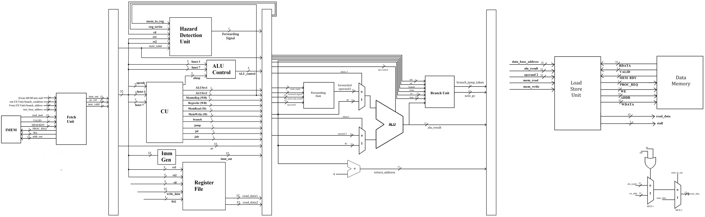
</div>

The control unit sits in the decode stage, so all control signals are produced as early as possible. They then travel with the instruction through the ID/EX, EX/MEM and MEM/WB pipeline registers. Branches and jumps are resolved in the execute stage, and the taken flag and target are registered in EX/MEM. From there, a taken branch redirects the fetch unit and flushes the IF/ID and ID/EX registers.

### Fetch Stage — Instruction Memory Controller

<div align="center">
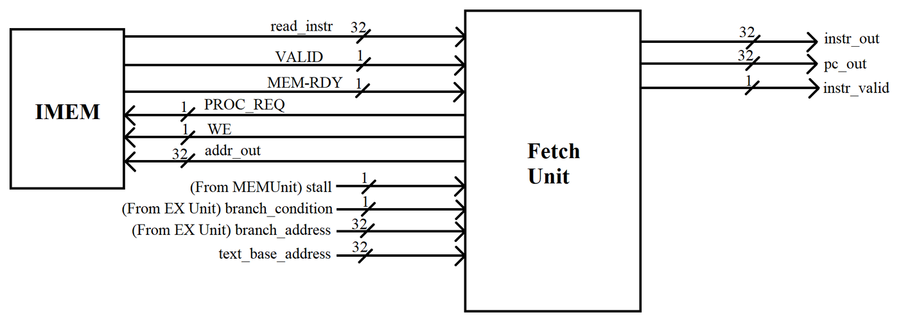
</div>

During testing we found that `mem_wrap_fake` stops responding for good if `MEM_RDY` goes high while `PROC_REQ` is low:

<div align="center">
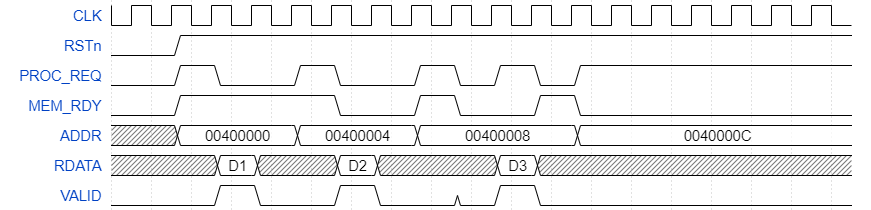
</div>

The fetch unit therefore keeps `PROC_REQ` high at all times. That means several requests can be in flight at once, and each returning instruction must be matched to the PC that requested it:

- **PC FIFO (16 entries).** Every accepted request (`PROC_REQ && MEM_RDY`) pushes its address. Every `VALID` pops one, so each instruction leaves the fetch unit with its correct PC.
- **Bubbles, not stalls.** While waiting for memory, the fetch unit issues `NOP` (`0x00000013`) with `instr_valid = 0`. `instr_valid` tells the hazard detection and forwarding logic which instructions are real.
- **Branch recovery.** After a taken branch or jump, the fetch unit keeps requesting from the new target. It discards incoming instructions as NOPs until the PC popped from the FIFO equals the target address.
- **Stall recovery.** When the LSU stalls the pipeline, the next PC is held. After the stall, instructions are discarded until the held PC comes back, so no instruction is skipped or repeated.

<div align="center">
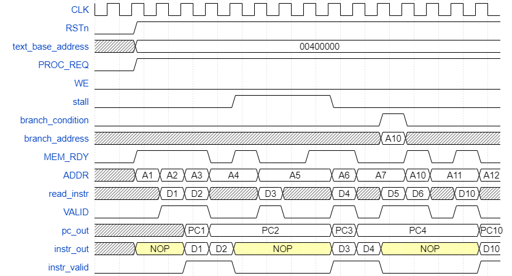
</div>

### Decode Stage

<div align="center">
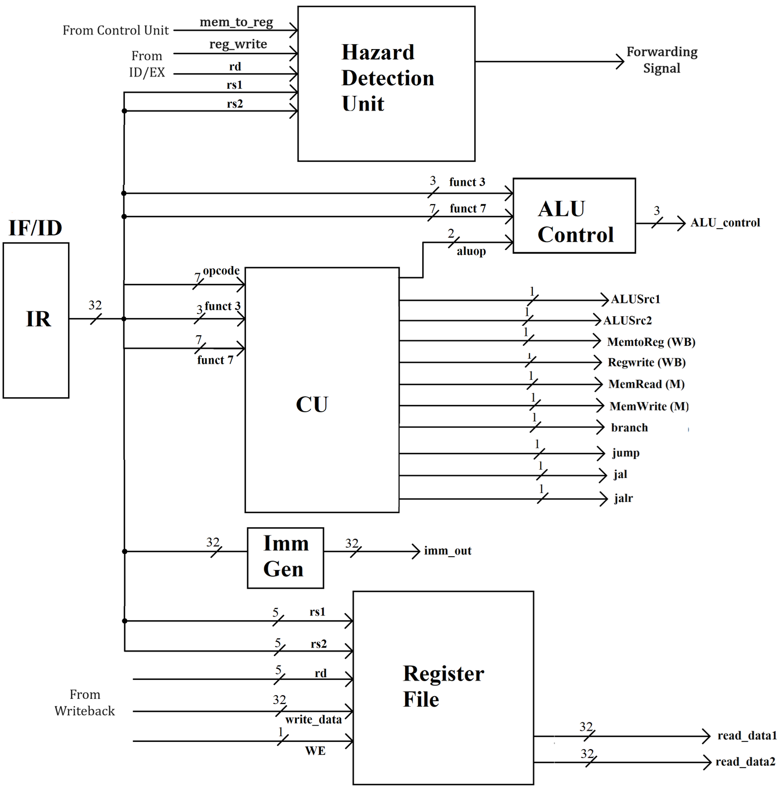
</div>

- **Decode / control unit.** Splits the instruction into opcode, rs1, rs2, rd, funct3 and funct7. Generates `alu_src1/2`, `alu_op`, `mem_read`, `mem_write`, `mem_to_reg`, `reg_write`, and separate `branch`, `jump`, `jal` and `jalr` flags.
- **ALU control.** Turns `alu_op`, funct3 and funct7 into one of five ALU operations: NOP, ADD, SUB, SLT (unsigned, for `bltu`) and SGE (signed, for `bge`).
- **Immediate generator.** Builds the sign-extended immediate for I, S, SB, U and UJ formats.
- **Register file.** 32 × 32-bit, synchronous write and asynchronous read, with `x0` hard-wired to 0. A write-through bypass returns `write_data` when a read hits the register being written in the same cycle.
- **Hazard detection unit.** Compares the current instruction's rs1/rs2 with the rd of the previous *valid* instruction. On a match (and not a load), it raises `forward_signal`.

<div align="center">
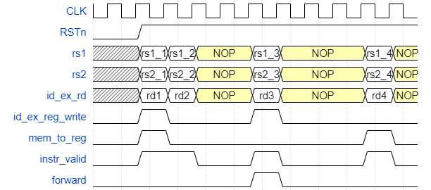
</div>

### Execute Stage

<div align="center">
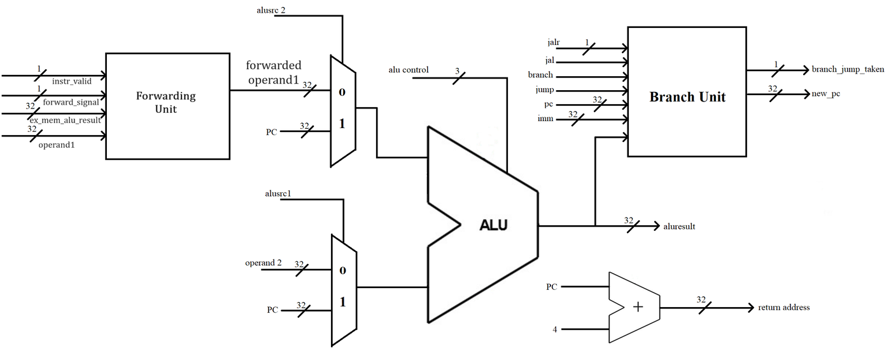
</div>

The execute stage holds the ALU, the forwarding unit, the branch unit and a separate PC + 4 adder for return addresses.

- **Forwarding unit.** When `forward_signal` is set, it replaces operand 1 with the previous ALU result from EX/MEM.
- **Branch unit.** Computes the target: PC + offset for branches and `jal`, register + offset with the LSB cleared for `jalr`. A conditional branch is taken when the ALU compare returns 1.

<div align="center">
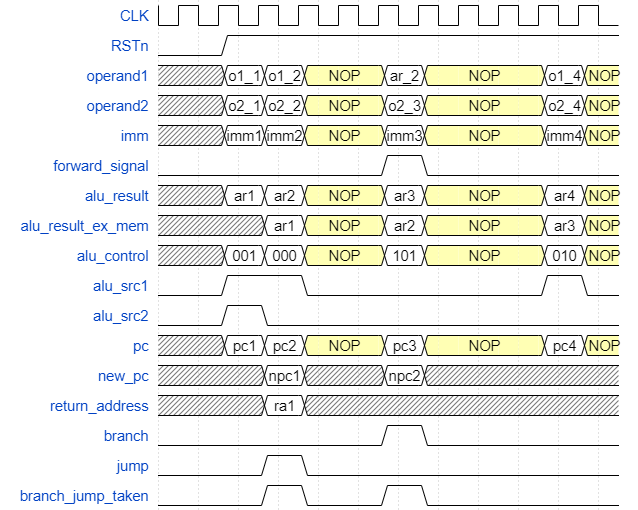
</div>

### Memory Stage — Load-Store Unit

<div align="center">
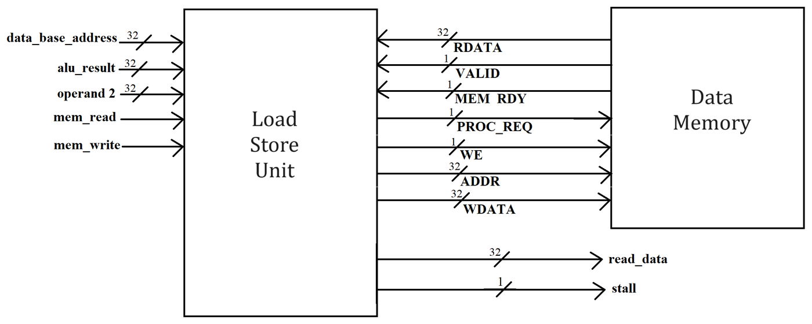
</div>

The LSU has the same `mem_wrap_fake` constraint, so it also keeps `PROC_REQ` high and issues dummy reads when no load or store is pending. A **request/response pairing scheme** tells real responses apart from dummy ones:

- A request counter increments on every `MEM_RDY`, and a response counter on every `VALID`.
- When a real `lw`/`sw` starts, the LSU records which request number it is.
- The pipeline is stalled until the response counter passes that number. The load data is captured one cycle later, and only then is the stall released.
- Edge detection on `mem_read`/`mem_write` stops a frozen EX/MEM register from issuing the same operation twice during the stall.

<div align="center">
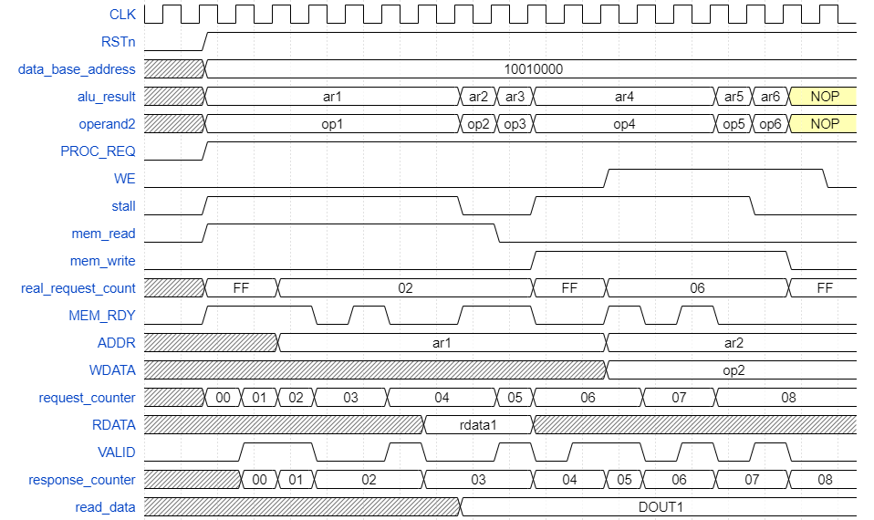
</div>

### Writeback Stage

<div align="center">
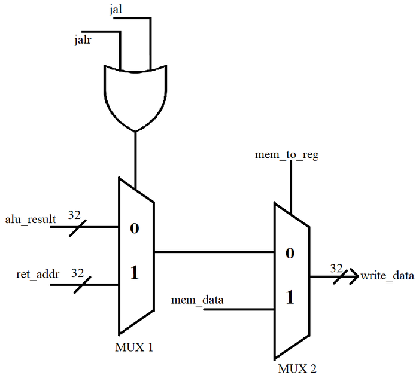
</div>

Two multiplexers select the value written to the register file: the ALU result, the return address (for `jal`/`jalr`) or the loaded data.

### SSRAM Wrapper

`sram_32_1024_wrapper` contains two `sram_32_1024_freepdk45` macros, one for instructions and one for data. A small FSM per memory (RST → WAIT → PROCESS → VALID) translates the request/ready protocol into the SSRAM's chip-select and write-enable timing. The macros are word-addressed, so byte addresses are divided by 4.

ASIC SRAMs can't be initialized at design time. The SSRAM testbench therefore drives a multiplexer (`init_imem` / `init_dmem`) that first writes `main.bin` and `data.bin` into the macros, then releases reset and starts the core.

---

## Results

### Logic Synthesis — Core

| Metric | Value |
|---|---|
| Clock period (slack met) | **1.56 ns** |
| Max frequency | **641.03 MHz** |
| Total cell area | 23,340.17 µm² |
| Combinational / sequential cells | 9,907 / 2,469 |
| Dynamic / leakage power (at f_max) | 10.69 mW / 0.47 mW |
| Critical path | `id_ex_stage/forward_signal_reg` → forwarding mux → ALU → `ex_mem_stage/alu_result_reg[31]` |

### Place & Route — Core (Cadence Innovus 20.11)

<div align="center">
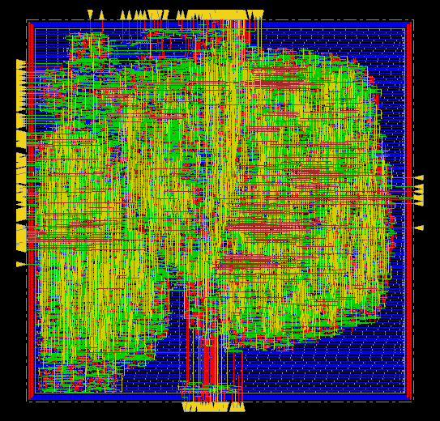
</div>

| Metric | Value |
|---|---|
| Clock period | 1.56 ns (same as synthesis) |
| Setup WNS / TNS | +0.180 ns / 0 |
| Hold WNS / TNS | +0.126 ns / 0 |
| Area | 22,433.1 µm² |
| Gate count / cells | 28,111 / 11,080 |
| Placement density | 57.6 % |
| DRC / connectivity | No violations / no problems |

### Logic Synthesis — SSRAM Wrapper

| Metric | Value |
|---|---|
| Clock period (slack met) | 0.74 ns |
| Max frequency | 1.35 GHz |
| Total area | 100,370.07 µm² (99,941.81 µm² of it is the two SRAM macros) |

The wrapper is far faster than the core, so the core's 641 MHz sets the speed of the complete system.

### Functional Verification

`maxx` produces the following data memory after execution. The same values appear in RARS, in RTL simulation with both memory types, and in every gate-level simulation:

| Address | Symbol | Value |
|---|---|---|
| `0x10010000` | `sS[0..3]` | 0, −1024, −512, −256 |
| `0x10010010` | `Lo[0..1]` | 15, −20 |
| `0x10010018` | `Li` | 31 |
| `0x1001001C` | `sE[0..3]` (result) | **0, −276, 26, −210** (`0x00000000`, `0xFFFFFEEC`, `0x0000001A`, `0xFFFFFF2E`) |

---

## Repository Structure

```
Lab3-RISCV-Lite-Processor/
├── maxx-project/                  # Application and build flow (course-provided)
│   ├── main.c, maxx.c, maxx.h     # maxx C source
│   ├── crt0.s, riscv32-isa.ld     # Start-up code and linker script
│   ├── makefile                   # Compiles and dumps main.hex / data.hex
│   ├── extract_code.sh, extract_data.sh
│   ├── main.hex, data.hex         # objdump output
│   ├── main.txt, main.asm, main.bin, data.txt
│
├── riscv-lite/                    # Step 1: core with request/ready memory interface
│   ├── src/
│   │   ├── package.sv             # Opcodes, funct codes, ALU operation codes
│   │   ├── riscv_lite_top.sv      # Top level (module riscv_top)
│   │   ├── reg32.sv, 21mux.sv     # Generic register and 2:1 mux
│   │   ├── if_unit/if_unit.sv     # Fetch unit + instruction memory controller
│   │   ├── id_unit/               # id_unit, control_unit, alu_control, imm_gen, register_file, hdu
│   │   ├── ex_unit/               # ex_unit, alu, branch_unit, fwd_unit
│   │   ├── mem_unit/mem_unit.sv   # Load-store unit
│   │   ├── wb_unit/wb_unit.sv     # Writeback muxes
│   │   └── if_id_stage.sv, id_ex_stage.sv, ex_mem_stage.sv, mem_wb_stage.sv
│   ├── tb/tb.sv                   # Testbench with two mem_wrap_fake instances (module riscv_top_tb)
│   ├── sim/                       # Memory images: text_init.hex, main.bin, data_init.hex, data.bin
│   ├── syn/
│   │   ├── .synopsys_dc.setup
│   │   ├── synthesis.tcl          # compile at WCP = 1.56 ns
│   │   └── reports/               # Timing, area, power, clock at f_max
│   └── pnr/reports/               # Innovus gate count, DRC, connectivity, post-route setup/hold summaries
│
├── ssram_wrapper/                 # Step 2: SSRAM instruction and data memories
│   ├── src/sram_wrapper.sv        # sram_32_1024_wrapper: 2 macros + request/ready FSMs
│   ├── tb/tb_ssram.sv             # Core + wrapper, with memory initialization mux (module riscv_ssram_tb)
│   ├── sim/                       # Same memory images as riscv-lite/sim
│   ├── syn/
│   │   ├── .synopsys_dc.setup     # Includes the SSRAM .db
│   │   ├── syn_wrapper.tcl        # compile at WCP = 0.74 ns
│   │   └── reports/
│   └── sram_32_1024_freepdk45/    # OpenRAM macro: Verilog model, .lib/.db timing
│
├── docs/                          # Block diagrams, timing diagrams, Innovus layout
├── LICENSE
└── README.md
```

---

## Interface

`riscv_top` exposes two independent request/ready ports, one for instructions and one for data:

```
CLK                    : in  logic           -- Clock
RSTn                   : in  logic           -- Asynchronous active-low reset
enable                 : in  logic           -- Pipeline enable
text_base_address_top  : in  logic [31:0]    -- First instruction address (0x00400000)
data_base_address_top  : in  logic [31:0]    -- First data address (0x10010000)

-- Instruction memory port
imem_proc_req_top      : out logic           -- Request (held high)
imem_rdy_top           : in  logic           -- Memory ready
imem_addr_out_top      : out logic [31:0]    -- PC
imem_we_top            : out logic           -- Always 0
read_instr_top         : in  logic [31:0]    -- Instruction
imem_valid_top         : in  logic           -- Instruction valid

-- Data memory port
dmem_proc_req_top      : out logic           -- Request (held high)
dmem_rdy_top           : in  logic           -- Memory ready
dmem_addr_out_top      : out logic [31:0]    -- Load/store address
dmem_we_top            : out logic           -- Write enable
dmem_wdata_top         : out logic [31:0]    -- Store data
read_data_top          : in  logic [31:0]    -- Load data
dmem_valid_top         : in  logic           -- Response valid (reads and writes)
```

A transaction is accepted on the rising edge where `PROC_REQ` and `MEM_RDY` are both high. Responses arrive in order, one `VALID` per accepted request, any number of cycles later.

---

## Tools & Environment

| Tool | Purpose |
|---|---|
| `riscv32-unknown-elf-gcc` / `objdump` | Cross-compiling `maxx`, extracting code and data |
| RARS 1.6 | Reference instruction-set simulation |
| QuestaSim | RTL, post-synthesis and post-route simulation |
| Synopsys Design Compiler S-2021.06-SP4 | Logic synthesis |
| Cadence Innovus 20.11 | Floorplan, placement, CTS, routing, sign-off checks |
| NanGate 45nm OCL | Standard cell library |
| OpenRAM | SSRAM macro generation (`sram_32_1024_freepdk45`) |

---

## Running the Design

### 1. Compile the Application

```bash
# From maxx-project/ (set RISCV_PATH in the makefile to your toolchain)
make clean
make all                                            # → main.hex, data.hex
./extract_code.sh main.hex main.txt main.asm
cat main.txt | sed 's/.*://' | sed '/^[[:space:]]*$/d' > main.bin
./extract_data.sh data.hex data.txt
```

`main.bin` and `data.bin` are already provided in each `sim/` folder, together with `text_init.hex` and `data_init.hex`. The testbenches read these four files from the directory the simulator runs in.

### 2. RTL Simulation with SSRAMs (QuestaSim)

This version can be simulated by anyone, because the OpenRAM model is plain Verilog.

```bash
# From ssram_wrapper/sim/
vlib work
vlog -work ./work ../../riscv-lite/src/package.sv
vlog -work ./work ../../riscv-lite/src/reg32.sv
vlog -work ./work ../../riscv-lite/src/21mux.sv
vlog -work ./work ../sram_32_1024_freepdk45/sram_32_1024_freepdk45.v
vlog -work ./work ../src/sram_wrapper.sv
vlog -work ./work ../../riscv-lite/src/if_unit/if_unit.sv
vlog -work ./work ../../riscv-lite/src/id_unit/register_file.sv
vlog -work ./work ../../riscv-lite/src/id_unit/imm_gen.sv
vlog -work ./work ../../riscv-lite/src/id_unit/hdu.sv
vlog -work ./work ../../riscv-lite/src/id_unit/control_unit.sv
vlog -work ./work ../../riscv-lite/src/id_unit/alu_control.sv
vlog -work ./work ../../riscv-lite/src/id_unit/id_unit.sv
vlog -work ./work ../../riscv-lite/src/ex_unit/alu.sv
vlog -work ./work ../../riscv-lite/src/ex_unit/branch_unit.sv
vlog -work ./work ../../riscv-lite/src/ex_unit/fwd_unit.sv
vlog -work ./work ../../riscv-lite/src/ex_unit/ex_unit.sv
vlog -work ./work ../../riscv-lite/src/mem_unit/mem_unit.sv
vlog -work ./work ../../riscv-lite/src/wb_unit/wb_unit.sv
vlog -work ./work ../../riscv-lite/src/if_id_stage.sv
vlog -work ./work ../../riscv-lite/src/id_ex_stage.sv
vlog -work ./work ../../riscv-lite/src/ex_mem_stage.sv
vlog -work ./work ../../riscv-lite/src/mem_wb_stage.sv
vlog -work ./work ../../riscv-lite/src/riscv_lite_top.sv
vlog -work ./work ../tb/tb_ssram.sv
vsim work.riscv_ssram_tb -voptargs=+acc -t 1ps
```

Then run `add wave -r /*` and `run 1200 ns`. The register file (`/riscv_ssram_tb/dut/id_unit/reg_file/registers`) and the data SSRAM (`/riscv_ssram_tb/memories_wrapper/sram_dmem/mem`) can be inspected in the Memory window. Words 7–10 of data memory should hold the `sE` values above.

### 3. RTL Simulation with `mem_wrap_fake`

`tb/tb.sv` uses `mem_wrap_fake`, a variable-latency memory model that the course supplied only as a precompiled QuestaSim library. It is **not included** in this repository. If you have it, compile it into `riscv-lite/sim/work`, then compile the same `riscv-lite/src` files in the order above (without the SSRAM files) followed by `tb/tb.sv`, and run:

```bash
vsim work.riscv_top_tb -voptargs=+acc     # then: run 1100 ns
```

### 4. Logic Synthesis (Synopsys Design Compiler)

```bash
# From riscv-lite/syn/ (core) or ssram_wrapper/syn/ (wrapper)
mkdir -p reports ../netlist
dc_shell -f synthesis.tcl          # core, WCP = 1.56 ns
dc_shell -f syn_wrapper.tcl        # wrapper, WCP = 0.74 ns
```

Both scripts write the netlist, SDF and SDC to `../netlist/` (not included in this repository). `.synopsys_dc.setup` points to the Politecnico di Torino server paths for the NanGate library and DesignWare; edit `search_path` for your installation.

### 5. Place & Route (Cadence Innovus)

Innovus was run interactively on the synthesized netlist (`riscv.v`, `riscv.sdc`) with the NanGate LEF and timing library. The flow was:

1. **Floorplan:** aspect ratio 1.0, 60% core utilization, 5 µm core margins.
2. **Power:** VDD/VSS core rings (metal1/metal2, 0.8 µm), then special routing of the follow-pins.
3. **Placement:** timing-driven `place_design`, then `optDesign -preCTS`.
4. **Clock tree synthesis:** `ccopt_design`, with a target maximum transition of 0.08 ns and a target skew of 0.5 ns. Then `optDesign -postCTS` for setup and hold.
5. **Routing:** NanoRoute `routeDesign -globalDetail`, then `optDesign -postRoute` for setup and hold, with on-chip-variation analysis.
6. **Sign-off:** filler cells added, RC extracted, `timeDesign -postRoute`, `verifyConnectivity`, `verify_drc`, `reportGateCount`.
7. **Export:** the post-route netlist (`riscv_top.v`) and SDF (`riscv.sdf`) for back-annotated simulation.

The resulting reports are in `riscv-lite/pnr/reports/`.

### 6. Gate-level Simulation

Compile the netlist (`../netlist/riscv.v` after synthesis, or Innovus's `riscv_top.v` after P&R) in place of `src/`, plus `tb/tb.sv`. Simulate with the NanGate Verilog library and SDF back-annotation:

```bash
vsim -L <nangate45_verilog_lib> -sdftyp /riscv_top_tb/dut=../netlist/riscv.sdf work.riscv_top_tb -t 1ns
```

Use `-sdfmax` with the Innovus SDF for the post-route run.

---

## Design Decisions

**Why keep `PROC_REQ` high all the time?**  
`mem_wrap_fake` locks up if it signals ready while no request is pending. Holding the request high avoids that, but turns both memory controllers into pipelined requesters with several accesses in flight. The 16-entry PC FIFO in the fetch unit and the counters in the LSU exist because of this.

**Why bubbles in fetch but stalls in the LSU?**  
The fetch unit can keep the pipeline busy with NOPs while it waits, and the `instr_valid` flag stops those NOPs from triggering hazards. A load or store has to complete before later instructions can safely continue, so the LSU stalls the pipeline instead.

**Why a separate ALU control?**  
The control unit decodes only the opcode into a broad `alu_op`. The exact operation for instructions that share an opcode (`add`/`sub`, `bltu`/`bge`) is chosen from funct3 and funct7 in the ALU control. This keeps the main control unit simple.

**Why resolve branches in EX?**  
The branch compare reuses the ALU (SLT/SGE), and the target is computed next to it. Since the fetch unit already discards instructions until the target arrives, a taken branch just costs the instructions already in flight. No branch predictor is needed.

---

## Known Limitations & Future Work

The design runs `maxx` correctly at every stage of the flow, but some parts were simplified for this workload:

- **Partial forwarding.** The hazard unit only detects RAW dependencies between back-to-back instructions, the forwarding path only covers operand 1, and there is no load-use stall. This is safe for `maxx` because the fetch bubbles and LSU stalls space instructions far enough apart. A faster memory or a different program would need full forwarding and load-use stall logic.
- **Flush through reset.** Taken branches flush IF/ID and ID/EX by gating their asynchronous reset. A synchronous flush would follow good design practice better.
- **Inferred latches.** Some combinational blocks don't assign every output on every path: the branch unit, control unit, ALU control and hazard unit. As a result, synthesis infers 54 latches. Adding default assignments would remove them.
- **No performance counters.** Cycle and CPI counters would make it possible to quantify the stall and bubble overhead and compare the two memory systems.
- **SSRAM layout.** The OpenRAM macro was not shipped with a working LEF, so the SSRAM system was synthesized and simulated but not placed and routed.

---

## Academic Context

Developed as part of the **Integrated Systems Architectures** course at **Politecnico di Torino** (MSc Electronic Engineering — Embedded Systems), 2023–2024.

**References**

1. [The RISC-V Instruction Set Manual, Volume I: Unprivileged ISA](https://riscv.org/specifications/)
2. D. A. Patterson and J. L. Hennessy, *Computer Organization and Design RISC-V Edition* — RISC-V Reference Data Card
3. [OpenHW Group OBI](https://github.com/openhwgroup/obi) — the bus protocol that the request/ready interface is based on
4. [OpenRAM](https://openram.org/) — SRAM compiler used to generate the SSRAM macro
5. [RARS](https://github.com/TheThirdOne/rars) — RISC-V assembler and runtime simulator

## License

The processor RTL, testbenches, scripts and documentation are released under the [MIT License](LICENSE). The `maxx` application, start-up code, linker script and build scripts in `maxx-project/` were provided by the course. The SSRAM model in `ssram_wrapper/sram_32_1024_freepdk45/` was generated with OpenRAM.
